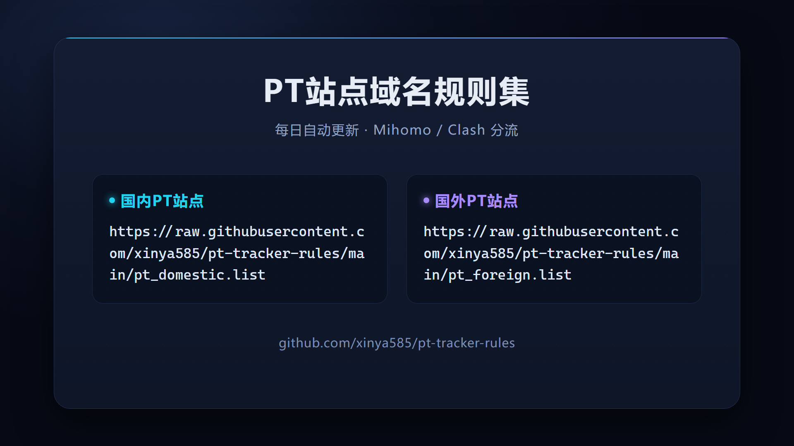

# PT Site Rulers (Fresh)

PT 站点域名规则集，适用于 **Mihomo** (Clash Meta) / Clash 内核的代理分流配置。

本仓库是 `maple-zh/pt-site-rulers` 的全新整理版：以 **PT监护室 (savept.icu)** 的实时监测数据为主体重建域名列表，并标注各站点健康状态，同时保留原社区整理的覆盖面。

## 数据来源与时间

- **PT监护室** (https://savept.icu) 快照：`2026-10-10`
- 站点存活状态、当前域名、内/外站类型均取自该监测数据
- 原社区整理 PT 站点配置文件用于补全覆盖

## ⚠️ 重点 · 规则集链接（复制即用）

> **📦 国内PT站点**
> `https://raw.githubusercontent.com/xinya585/pt-tracker-rules/main/pt_domestic.list`
>
> **📦 国外PT站点**
> `https://raw.githubusercontent.com/xinya585/pt-tracker-rules/main/pt_foreign.list`
>
> 规则集**每日自动更新**（北京时间 08:00）。复制上方链接填入 Mihomo 的 `rule-providers` 即可使用。

> 一张可直接分享的卡片版（点击放大）：
>
> 

## 文件说明

| 文件 | 分类 | 规则数 |
|---|---|---|
| `pt_domestic.list` | 国内 PT 站点 | 182 |
| `pt_foreign.list` | 国外 / 国际 PT 站点 | 65 |
| **合计** | | **247** |

> 规则均为 `DOMAIN-SUFFIX` 格式（自动匹配子域）。国内列表含主站与备用/API 域名（如 m-team、xingyunge 系列）。

## 健康状态标注

列表内通过行尾注释标注站点健康度，便于识别可清理项：

- `# [已关站]` — 站点已关站 / 死亡（监护室判定的明确关站）
- `# [病危]` — 监控异常、暂不可达，正被抢救（可能恢复）
- `# [状态未知]` — 监护室未收录，状态待确认

> 提示：Mihomo 的 text 规则源支持 `#` 注释，带标注的行可直接保留；若你的站点列表希望更干净，可自行删除 `[已关站]` 行。

## 使用方法

### 1. 添加 rule-providers

在 Mihomo 配置的 `rule-providers` 中添加（替换为你的用户名）：

```
rule-providers:
  pt_domestic:
    type: http
    behavior: classical
    format: text
    interval: 86400
    url: "https://raw.githubusercontent.com/xinya585/pt-tracker-rules/main/pt_domestic.list"

  pt_foreign:
    type: http
    behavior: classical
    format: text
    interval: 86400
    url: "https://raw.githubusercontent.com/xinya585/pt-tracker-rules/main/pt_foreign.list"
```

### 2. 添加 rules

在 `rules` 中添加匹配规则，**放在 `geolocation-!cn` 之前**，防止 PT 域名被误判走代理：

```
rules:
  # ... 其他规则 ...
  - RULE-SET,pt_domestic,直连
  - RULE-SET,pt_foreign,直连
  # ...
```

### 3. 分流策略说明

- **国内 PT 站点**：直连（国内站点直连访问最快最稳）
- **国外 PT 站点**：直连（避免 IP 变动触发风控）

如果你的某些国内 PT 站无法直连，可单独将 `pt_foreign` 指向代理组：

```
  - RULE-SET,pt_foreign,默认代理
```

## 致谢

- 站点监测数据：**PT监护室** (https://savept.icu)
- 站点信息参考：社区整理的 PT 站点配置文件
- 项目灵感：`maple-zh/pt-site-rulers`

## 更新

规则集通过 GitHub Actions **每日自动更新**（北京时间 08:00），自动同步 PT监护室 的站点存活状态、当前域名并补全新站，有变化时自动提交推送。也可在仓库 **Actions → Update PT rules → Run workflow** 手动触发更新。
